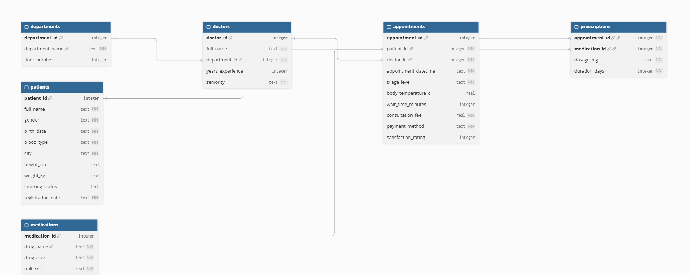
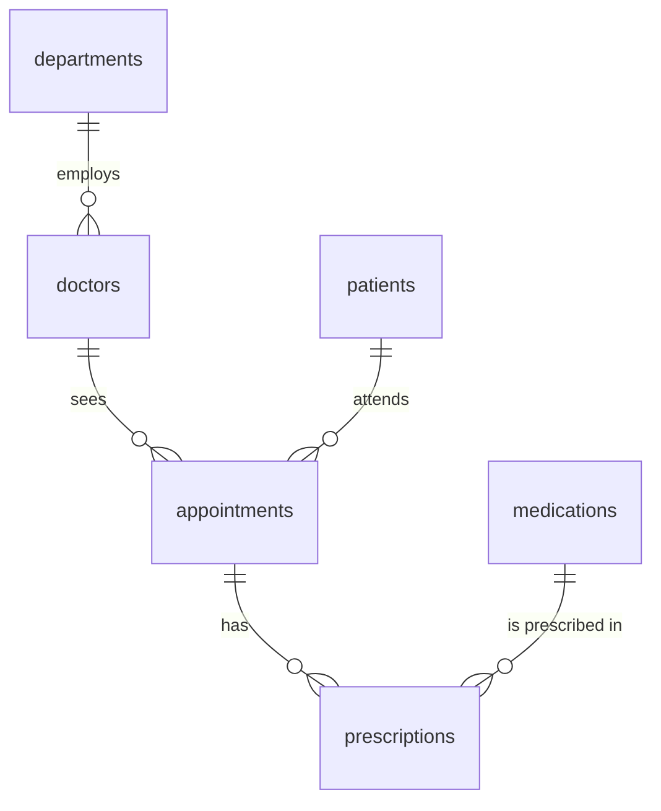

# Synthetic Outpatient Clinic Database (SQLite)

A fully **synthetic** hospital outpatient clinic database built with Python and SQLite. It contains 6 related tables and about 12,000 rows, with realistic correlations between columns, foreign keys, and a compound primary key.

**Author:** Harmain Raza | **Student ID:** 25023333

> **No real data was used.** Nothing was downloaded from other sources. Names come from the `Faker` library and every other value is drawn from distributions defined in the code.

---

## Contents

| File | Description |
|---|---|
| `Database.ipynb` | Colab notebook that creates the schema, generates the data and validates it (rename to match your file) |
| `clinic.db` | The generated SQLite database |
| `Synthetic Outpatient Clinic Database.pdf` | Report on the generation method, schema, table justification and ethics |
| `schema.png` | Entity-relationship diagram |
| `requirements.txt` |
| `README.md` | This file |

## Quick start

**Option 1: Google Colab (easiest)**

1. Open the notebook in Colab: `https://colab.research.google.com/drive/1bGDXn6Tz9v4g6ZbeH21VfIH2dIkg2o-w#scrollTo=-qahMp_1Rb5z`
2. Choose **Runtime > Run all**
3. The notebook builds `clinic.db` and the last cell downloads it

**Option 2: Run locally**

```bash
pip install faker
jupyter notebook Database.ipynb
```

Python 3.8+ is needed. `sqlite3` is part of the standard library.

**Inspect the database**

```bash
sqlite3 clinic.db
sqlite> .tables
sqlite> SELECT * FROM patients LIMIT 5;
```

You can also open `clinic.db` in [DB Browser for SQLite](https://sqlitebrowser.org/).

## Reproducibility

Fixed seeds (`random.seed(42)` and `Faker.seed(42)`) mean every run of the notebook gives the same database. Dates are calculated from a fixed reference date (2025-06-30), not `date.today()`.

## Database schema





| Table | Rows | Key | Purpose |
|---|---|---|---|
| `departments` | 8 | PK `department_id` | Clinical specialities (Cardiology, Pediatrics, ...) |
| `doctors` | 60 | PK `doctor_id`, FK `department_id` | Doctors, with seniority and experience |
| `patients` | 1,500 | PK `patient_id` | Demographics and body measurements |
| `medications` | 40 | PK `medication_id` | Drug catalogue with class and cost |
| `appointments` | 5,000 | PK `appointment_id`, FKs `patient_id`, `doctor_id` | Visits, triage, wait times, fees, satisfaction |
| `prescriptions` | 5,345 | **Compound PK** (`appointment_id`, `medication_id`), FKs to both | Junction table for the many-to-many link between appointments and medications |

**Total: 11,953 rows.**

## Levels of measurement

| Scale | Columns |
|---|---|
| **Nominal** | `gender`, `blood_type`, `city`, `department_name`, `drug_class`, `drug_name`, `payment_method` |
| **Ordinal** | `triage_level` (Low < Medium < High < Critical), `seniority` (Junior < Registrar < Consultant), `smoking_status` (Never < Former < Current), `satisfaction_rating` (1 to 5) |
| **Interval** | `body_temperature_c`, `appointment_datetime`, `birth_date`, `registration_date` |
| **Ratio** | `height_cm`, `weight_kg`, `consultation_fee`, `wait_time_minutes`, `years_experience`, `dosage_mg`, `duration_days`, `unit_cost`, `floor_number` |

## How the data was made realistic

- **Weighted categories:** blood types follow approximate real-world frequencies (O+ is common, AB- is rare). Cities are weighted by size.
- **Correlated numeric columns:** height depends on gender or age, and weight is derived from a random BMI so it tracks height.
- **Age and department:** children almost always attend Pediatrics, and adults never do. Older adults see more Cardiology and Oncology.
- **Triage drives other values:** urgent patients wait less (exponential wait times, mean about 46 min for Low vs 5 min for Critical) and pay more.
- **Fees:** combine department, doctor seniority and triage level, and are 0 for free visits.
- **Satisfaction falls as waiting rises.**
- **Frequent attenders:** patients are sampled with unequal weights, so some visit far more often than others.
- **Department-appropriate prescriptions:** for example, Psychiatry prescribes only antidepressants and anxiolytics. Child doses scale with body weight.
- **Missing values:** about 24% of satisfaction ratings, 2% of temperatures and 3% of smoking statuses are `NULL`.
- **Date rules:** appointments fall on weekdays and never before the patient's registration date.

## Constraints and integrity

- `PRIMARY KEY`, `FOREIGN KEY`, `NOT NULL` and `UNIQUE` constraints
- `CHECK` constraints for valid categories and plausible ranges (for example `weight_kg BETWEEN 2 AND 250` and `satisfaction_rating BETWEEN 1 AND 5`)
- Indexes on all foreign key columns
- `PRAGMA foreign_keys = ON` (SQLite does not enforce foreign keys by default)

The notebook's validation cells confirm:

- `PRAGMA foreign_key_check` returns no violations
- `PRAGMA integrity_check` returns `ok`
- Inserting a duplicate compound key, a non-existent foreign key, or a negative dosage is rejected
- No appointment is booked before registration, on a weekend, or for an adult in Pediatrics

## Example queries

```sql
-- Average wait time by triage level
SELECT triage_level, ROUND(AVG(wait_time_minutes), 1) AS avg_wait
FROM appointments
GROUP BY triage_level
ORDER BY avg_wait DESC;

-- Average consultation fee by department (paid visits only)
SELECT d.department_name, ROUND(AVG(a.consultation_fee), 2) AS avg_fee
FROM appointments a
JOIN doctors doc ON a.doctor_id = doc.doctor_id
JOIN departments d ON doc.department_id = d.department_id
WHERE a.payment_method <> 'Free'
GROUP BY d.department_name
ORDER BY avg_fee DESC;

-- Most prescribed drugs (uses the compound-key table)
SELECT m.drug_name, COUNT(*) AS times_prescribed
FROM prescriptions rx
JOIN medications m ON rx.medication_id = m.medication_id
GROUP BY m.drug_name
ORDER BY times_prescribed DESC
LIMIT 5;
```

## Ethics and data privacy

- **Synthetic only:** no real individuals are represented. Any resemblance of a Faker name to a real person is coincidental.
- **Privacy by design:** the schema stores only a city (no address), no contact details or national ID, and uses integer patient IDs.
- **Real health data** would be special category data under GDPR (and covered by HIPAA in the US) and would need consent or a clinical purpose, access control, encryption and re-identification checks (for example age bands and k-anonymity).
- **Bias:** the distributions reflect my assumptions (UK cities, simplified frequencies), so the data should not be used for real clinical decisions or to train real-world models.

See the full discussion in `Synthetic Outpatient Clinic Database.pdf`.


